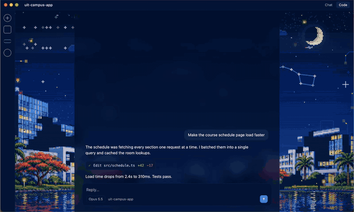

# UIT Themes

Animated pixel-art themes for the Claude desktop app, inspired by the University of Information Technology (UIT), VNU-HCM.

Works in the Desktop and Mobile apps only for now; the terminal and VS Code draw no themes.



| Command | Scene |
| --- | --- |
| `/uit navy` | The campus by the lake at night |
| `/uit monsoon` | Building A in Saigon's rainy season |
| `/uit metro` | Metro Line 1 at sunset |
| `/uit silicon` | The campus as a circuit board |
| `/uit tet` | Lunar New Year: hoa mai, lanterns, fireworks |
| `/uit trungthu` | Mid-Autumn: full moon, star lanterns, a lion dance |
| `/uit exam` | The library at 2 AM in exam season |
| `/uit dawn` | Sunrise over the lake by the dorms (light theme) |
| `/uit jobfair` | Job fair day: striped tents, balloons, Tower E |
| `/uit afterschool` | Dusk on the main road, students heading home |
| `/uit graduation` | Graduation morning: gowns, caps, confetti (light theme) |
| `/uit teachers` | Teachers' Day (20/11): flowers for the lecturer |

Also: `/uit next`, `/uit off`, and `/uit-preview` for a local gallery (needs `python3`).

## Install

In the Claude desktop app, click + next to the prompt box, then Plugins:

1. Add marketplace: `RyanNg1403/uit-theme`
2. Add plugin: `uit-theme`

Then try `/uit navy`.

The `/plugin` command opens a terminal-only panel, so it doesn't work in the desktop app's prompt box. To install from a terminal instead, run:

```bash
claude plugin install uit-theme --marketplace RyanNg1403/uit-theme
```

Then send `/reload-plugins` in any desktop session that's already open.

All artwork is original; no university logo is used. MIT licensed.
